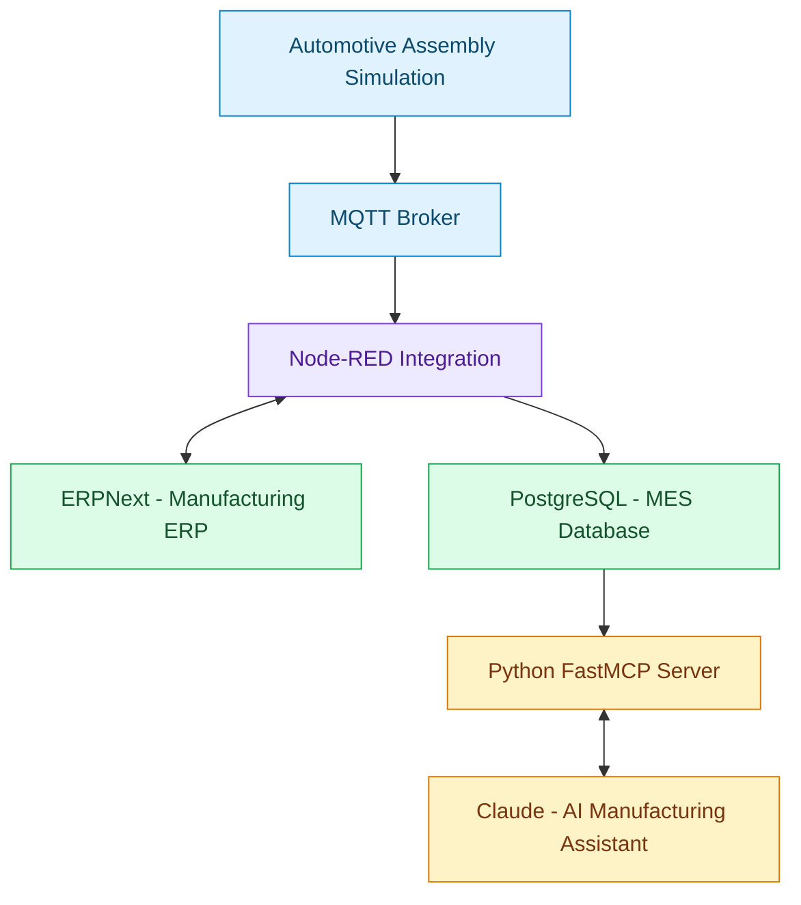

# Automotive Manufacturing Intelligence
### ERP | MES | Industrial IoT | AI Integration

**An end-to-end automotive assembly systems integration prototype**

A manufacturing digitalisation project connecting shop-floor telemetry, manufacturing execution, ERP transactions and an AI-powered traceability assistant.

Built to demonstrate practical industrial systems integration, production visibility and AI-assisted manufacturing analysis.

---

## System Architecture



Conceptual system architecture. Individual data flows and transaction boundaries are documented in the implementation.

---

## Technology Stack

| Layer | Technology |
|---|---|
| Manufacturing ERP | ERPNext v16 |
| Integration | Node-RED |
| Industrial messaging | MQTT |
| Manufacturing execution | PostgreSQL |
| AI interoperability | Python FastMCP |
| AI client | Claude Desktop |
| Infrastructure | Docker |

## Key Capabilities

### 1. Manufacturing ERP Integration
- Manufacturing work order retrieval
- BOM-based manufacturing transactions
- ERPNext manufacturing Stock Entry creation
- Work order and stock transaction linkage

### 2. Manufacturing Execution
- Simulated shop-floor telemetry
- Production quantity and rejection tracking
- MES batch records
- Work order production status

### 3. Serial-Level Traceability
- Serial number identification
- MES batch linkage
- Manufacturing work order reference
- ERPNext Stock Entry reference

### 4. AI Manufacturing Assistant
Three verified MCP tools:

| Tool | Function |
|---|---|
| `work_order_progress` | Retrieve MES production progress |
| `mes_batches` | Retrieve MES batch and ERP posting details |
| `trace_serial` | Trace serials to manufacturing and ERP references |

---

## Verified Demonstration

**Manufacturing Work Order:** `MFG-WO-2026-00003`

**Product:** `AAL-BRACKET-001`

**Example serial:** `AAL-BRACKET-001-000826`

```text
Serial: AAL-BRACKET-001-000826
            |
            v
MES Batch: MES-MFG-WO-2026-00003-826-835
            |
            v
Work Order: MFG-WO-2026-00003
            |
            v
ERP Stock Entry: MAT-STE-2026-00004
```

The example traceability chain has been verified through the MCP interface.

---

## Engineering Challenges

- Integration between ERP and shop-floor systems
- Manufacturing data consistency
- Serial and batch traceability
- Reconciliation of machine and ERP quantities
- AI access to structured operational data

## Current Status

**Working prototype**

Verified:
- ERPNext manufacturing transactions
- MQTT and Node-RED telemetry integration
- PostgreSQL MES reporting
- Serial-to-ERP traceability
- Three MCP tools accessible through Claude Desktop

Planned improvements:
- Automated production quantity reconciliation
- Production limit alerts
- Expanded exception detection
- Automated integration testing
- Reproducible deployment documentation

## Repository Structure

| Directory | Contents |
|---|---|
| `mcp-server/` | Python FastMCP implementation |
| `node-red/` | Integration flows |
| `database/` | PostgreSQL schema |
| `docs/` | Architecture documentation (planned) |
| `tests/` | Automated tests (planned) |

## Project Scope

This is a simulated manufacturing environment intended for engineering demonstrations and portfolio development. It is not a production-certified MES or ERP integration.

---
**Independent Engineering Portfolio Project**
