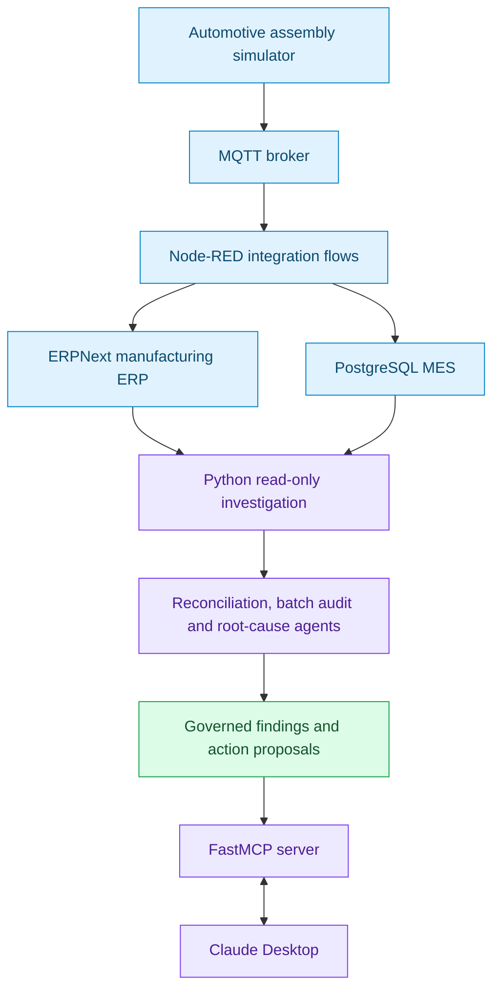

# Automotive ERP–MES–AI Integration Lab

**Industrial systems integration | Manufacturing data reconciliation | AI-assisted investigation**

A hands-on automotive assembly lab connecting an ERP system, a simulated manufacturing execution environment, shop-floor telemetry and an AI-accessible investigation layer. The project demonstrates how manufacturing data can be collected, reconciled, traced to individual transactions and presented for evidence-based human review.

**Current state:** Working local prototype with verified ERP–MES batch reconciliation and a read-only, multi-agent investigation exposed through Claude Desktop. The environment uses simulated production data; it is **not** a production-certified manufacturing solution.

## What this project demonstrates

- **ERP and shop-floor integration:** ERPNext manufacturing work orders and Stock Entries alongside MQTT-driven production telemetry and a PostgreSQL MES data model.
- **Production visibility:** Work-order progress, good/rejected quantities, machine counters and MES batch records.
- **Traceability:** Serial-to-batch, work-order and ERP manufacturing transaction references where those links exist.
- **Deterministic reconciliation:** Comparison of ERP manufactured quantities, MES batches and submitted manufacturing Stock Entries, including unmatched transactions.
- **AI-assisted investigation:** Five-agent analysis, root-cause hypotheses and proposed corrective actions delivered through Python FastMCP and Claude Desktop.
- **Governance:** Investigation and proposal generation remain read-only against ERPNext and MES; exceptions require human review rather than automatic remediation.

## System architecture



The Node-RED integration layer and the Python investigation layer have **different permissions and responsibilities**. Manufacturing transaction posting exists in the integration prototype; AI-driven investigation does not post, amend or close ERP records. The exported manufacturing-posting flow was observed to begin with a manual inject node, not a continuously scheduled batch-posting trigger.

## Technology stack

| Layer | Technology | Role |
| --- | --- | --- |
| Manufacturing ERP | ERPNext | Work orders, BOMs, manufacturing Stock Entries |
| Manufacturing execution | PostgreSQL | Production events, batch records and work-order progress |
| Shop-floor simulation | MQTT | Production and machine telemetry |
| Integration orchestration | Node-RED | Data routing and ERP/MES integration flows |
| Investigation and data access | Python | Live queries, transaction reconciliation and root-cause analysis |
| AI tool interface | FastMCP | Tools for structured manufacturing investigation |
| AI client | Claude Desktop | Natural-language interaction with the investigation tools |
| Local infrastructure | Docker | Containerised components |

## Implemented capabilities

### ERP and MES integration

- Read ERPNext work-order data and inspect submitted manufacturing Stock Entries.
- Capture simulated production, rejection and machine-counter data in the MES environment.
- Record MES batches with ERP Stock Entry references where available.
- Trace an example serial through MES batch, manufacturing work order and ERP transaction.
- Reconcile ERP manufacturing entries against the MES batch ledger without changing source records.

### Multi-agent investigation

The investigation workflow combines role-specific analysis across production, machine data, ERP reconciliation, supporting exception analysis and governance. Its deterministic evidence checks are separated from explanatory hypotheses.

| Module | Responsibility |
| --- | --- |
| `agents/run_live.py` | Gather live ERP and MES evidence and produce an investigation snapshot |
| `agents/root_cause.py` | Analyse discrepancies, rank findings and recommend corrective actions |
| `agents/batch_audit.py` | Match MES batches to submitted ERP manufacturing Stock Entries |
| `agents/posting_agent.py` | Produce a posting proposal and risk assessment **without executing it** |
| `agents/integrated_investigation.py` | Combine root-cause and transaction-level reconciliation outputs |
| `mcp-server/server.py` | Expose investigation functions to Claude Desktop through FastMCP |

Verified MCP capabilities include `work_order_progress`, `mes_batches`, `trace_serial`, `investigate_work_order`, `investigate_root_cause` and `investigate_integrated_work_order`. These tools enable both targeted queries and a combined investigation of a manufacturing work order.

## Verified demonstration: work-order reconciliation

**Work order:** `MFG-WO-2026-00003`
**Item:** `AAL-BRACKET-001`
**Environment:** Simulated automotive assembly production

In a verified investigation, ERPNext recorded **20 manufactured units** against a **1,200-unit target**, while the MES production counter was substantially higher. Transaction-level auditing explained how the 20 ERP units were recorded:

| Reconciliation evidence | Observed result |
| --- | ---: |
| ERP target quantity | 1,200 |
| ERP manufactured quantity | 20 |
| Submitted ERP manufacturing Stock Entries | 2 |
| MES batch records | 1 |
| MES-linked manufacturing quantity | 10 |
| Unmatched ERP manufacturing quantity | 10 |
| Root-cause findings generated | 5 |
| Governance decision | `HUMAN_REVIEW_REQUIRED` |
| ERP/MES writes by investigation | 0 |

**Confirmed traceability match**

```text
Serial: AAL-BRACKET-001-000826
  -> MES batch: MES-MFG-WO-2026-00003-826-835
  -> Work order: MFG-WO-2026-00003
  -> ERP Stock Entry: MAT-STE-2026-00004 (10 units)
```

**Unmatched transaction:** `MAT-STE-2026-00003` is another submitted manufacturing Stock Entry for **10 units**, created on **29 October 2026**, with no corresponding MES batch reference in the audited batch ledger.

This establishes a **traceability gap**, not proof of a duplicate, erroneous or unauthorised ERP transaction. The entry may originate from earlier test activity; its creation mechanism has not been conclusively established.

### Outstanding discrepancies and hypotheses

The integrated investigation also identified:

1. **Production target overrun:** MES good production exceeded the 1,200-unit target; simulator target-enforcement logic requires review.
2. **Batch coverage gap:** Only 10 good units were represented in the MES batch ledger during the verified run.
3. **ERP posting coverage gap:** MES batch-linked manufacturing posted to ERP covered only a small portion of MES good production.
4. **ERP transaction traceability gap:** One 10-unit Stock Entry lacked a corresponding MES batch reference.
5. **Machine counter baseline gap:** The machine good counter exceeded MES good quantity by 6,253 units, consistent with—but not proof of—a cumulative counter baseline issue.

The root-cause explanations remain **hypotheses until independently verified**. ERP, MES and machine values are queried sequentially, so the investigation is **not an atomic cross-system snapshot**. Production counters may change between reads.

## Run the investigation

With the local ERPNext, PostgreSQL MES and MCP environment already configured and running, execute from the repository root:

```powershell
py .\agents\integrated_investigation.py MFG-WO-2026-00003
```

The command combines live investigation and batch-audit results, and writes a local report to:

```text
reconciliation/integrated_report.json
```

Alternatively, use Claude Desktop with the registered FastMCP tool:

```text
Call investigate_integrated_work_order for MFG-WO-2026-00003.
Identify unmatched ERP manufacturing entries, distinguish observed
facts from root-cause hypotheses, and show the governance decision.
Do not modify ERP or MES data.
```

**Prerequisites:** Running local services, valid read access to ERPNext and PostgreSQL MES, and the project's configured Python dependencies. This README documents an already-configured lab; a clean-machine deployment guide and automated setup tests are future work.

## Governance and safety boundaries

- The integrated investigation is **read-only** against the ERP and MES source systems.
- The posting agent generates **proposals**, not manufacturing transactions.
- `HUMAN_REVIEW_REQUIRED` is an investigation decision, **not** a completed approval workflow.
- No AI-initiated Stock Entry creation, work-order closure or automatic corrective-action execution is enabled.
- Verified observations are distinguished from inferred root causes.
- Secrets are kept in local environment configuration and must not be committed to Git.
- The manufacturing event stream and transactions are part of a **simulation / engineering lab**, not live plant operations.

## Repository map

| Location | Contents |
| --- | --- |
| `agents/` | Live investigation, batch auditing, root-cause analysis and proposal generation |
| `mcp-server/` | FastMCP implementation and tool definitions |
| `erpnext/` | ERPNext data-access utilities used by the lab |
| `node-red/` | Exported integration flow configuration |
| `database/` | MES database materials |
| `reconciliation/` | Local investigation outputs and reports; generated artifacts should remain untracked |

## Roadmap

| Phase | Planned improvement | Status |
| --- | --- | --- |
| Integrated investigation | Read-only ERP–MES reconciliation and Claude MCP tool | **Verified in local lab** |
| Sprint 4 | Human approval/rejection workflow, decision audit trail and simulated outcome verification | Planned |
| Production controls | Work-order target enforcement and counter baseline handling | Planned |
| Integration reliability | Repeatable batch generation, posting idempotency and safer retry behaviour | Planned |
| Engineering quality | Automated tests, deployment instructions and reproducible demonstrations | Planned |

## Project context

This is an **independent engineering portfolio project** focused on manufacturing digitalisation, ERP/MES integration, production traceability and practical AI oversight. It illustrates a progression from **data collection → reconciliation → investigation → governed recommendation**. Approval execution and remediation remain future capabilities.
